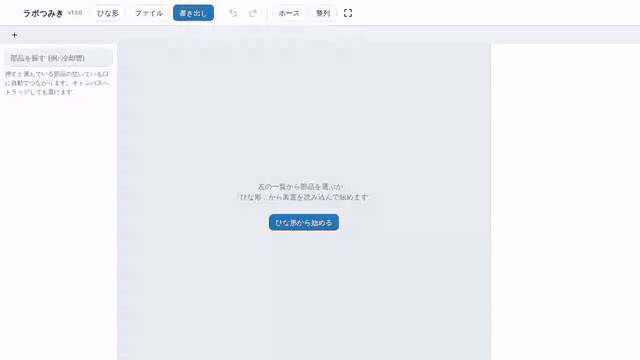
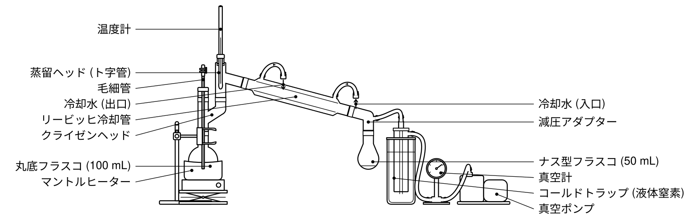
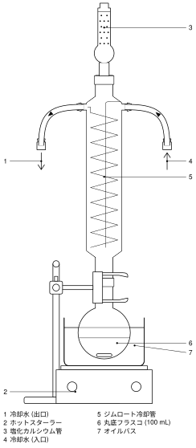
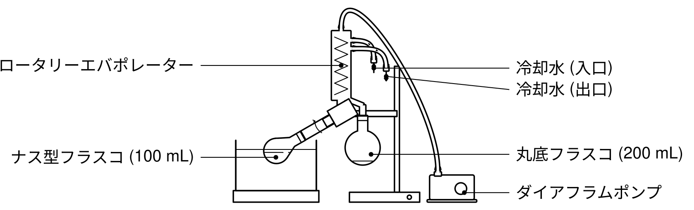

<p align="center"></p>

# ラボつみき (LabTsumiki) v1.2.0

実験器具を**積み木のようにつないで**、論文・レポートにそのまま貼れる白黒の実験装置図を作るウェブアプリです。
ブラウザだけで動き、データをどこにも送りません。

**▶ 使う: https://ebonyebonite.github.io/labtsumiki/**

<p></p>
<p>動画: <a href="docs/demo.mp4">docs/demo.mp4</a> (約 15 秒)</p>

<p>


</p>
<p></p>

## 使い方

1. 「ひな形」から装置を読み込むか、左の一覧から部品を置きます。
2. 部品を選んだまま次の部品を押すと、空いている口に自動でつながります (フラスコ → クライゼンヘッド → 蒸留ヘッド → 冷却管 …)。ドラッグして口を近づけても吸い付きます。
3. 部品を押すと、大きさ・液量・すり合わせの規格などを右の欄で変えられます。
4. 「書き出し」で SVG / PNG / 印刷 (PDF) にします。
5. 部品やホース、何もない所を**右クリック**すると、回転・反転・複製・削除・ラベル・クリップなどのメニューが出ます。スマホ・iPad では**長押し**で同じメニューが出ます。
6. 上のタブで複数の図を同時に開けます (＋ で新しい図、タブを押して切り替え、選んでいるタブを押すと名前を変更)。

## できること

| | |
|---|---|
| **積み木のように組む** | すり合わせ (14/20・24/40 などのオス/メス)、台と底、口と足などの「接続口」でつながります。大きさ違いのすり合わせは自動で合わせます。 |
| **自動調整** | マントルヒーターや浴は載せたフラスコに合わせた大きさに。温度計の球部は蒸留ヘッドの枝管の高さに、毛細管はフラスコの底まで自動で入ります。減圧アダプター・分配器は冷却管の傾きに関係なくまっすぐ立ちます。 |
| **自動整列** | 机に置く物を同じ床に揃え、受け器が机に当たらないようジャッキの高さを合わせ、スタンドをクランプの位置に立てます。 |
| **ホース** | ホース口を順に押すとホースでつなぎます。冷却水には流れの向きの矢印が付きます。 |
| **ラベル** | 番号 + 凡例 / 番号だけ (説明は本文へコピー) / 名前を直接。左右に振り分けて重ならないよう並べ、ドラッグで好きな位置へ動かすこともできます。日本語と英語。 |
| **すり合わせのクリップ** | すべて、またはつながりごとにクリップを描けます。 |
| **PC・スマホ・iPad** | PC は右クリックのメニュー (Shift+F10 でも)。スマホ・iPad は長押しのメニュー、2 本指で拡大・移動、部品のダブルタップで設定を開く。指で押しやすいよう当たり判定を広げています。Apple Pencil で描いている間は手のひらのタッチを無視し、ノッチ・Dynamic Island・ホームバーの所は避けて表示します。 |
| **タブ** | 複数の図を同時に開いて切り替えられます。ひな形やファイルは、今の図が空でなければ新しいタブで開きます。すべてのタブは自動で保存されます。 |
| **装置の確認** | 冷却水のつなぎ忘れ・逆向き、密閉した装置の加熱などを警告します。 |
| **書き出し** | SVG・PNG (300〜1200 dpi)・印刷 / PDF。図の幅 (1 段 85 mm、2 段 175 mm など) を決めると、線の太さ (mm) と文字 (pt) が書き出した図の上で指定どおりになります。 |

**器具** (約 50 種): 丸底・二口・三口・ナス型・三角・シュレンクフラスコ、吸引瓶、ビーカー、試験管、蒸留ヘッド、クライゼンヘッド、減圧アダプター、分配器 (牛の角)、変換アダプター、リービッヒ・アリン・ジムロート冷却管、ビグリューカラム、空冷管、滴下ロート、分液ロート、ロート、ブフナーロート、ビュレット、ソックスレー抽出器、カラムクロマトグラフィー、ロータリーエバポレーター、温度計、毛細管、栓・セプタム、塩化カルシウム管、マントルヒーター、浴、スターラー、ジャッキ、三脚と金網、ガスバーナー、スタンド、クランプ、真空ポンプ・アスピレーター、コールドトラップ、真空計、シュレンクライン、バブラー、ガスボンベ、風船 など。

**ひな形** (13 種): 減圧蒸留、常圧蒸留、分留 (分配器付き減圧蒸留)、加熱還流、ソックスレー抽出、ロータリーエバポレーター、カラムクロマトグラフィー、シュレンクライン、不活性ガス下の反応、吸引ろ過、滴定、分液、ガスバーナー加熱。

## ライセンス

- 作った図: **CC0 (パブリックドメイン)**。出典の表示なしで論文・レポート・授業資料に使えます。
  器具の絵はすべてこのアプリのコードが描いたもので、ほかの素材は使っていません。
- アプリのソースコード: [MIT ライセンス](LICENSE)。

## 開発者向け

ライブラリもビルドも使わない素の ES モジュールです。`index.html` を静的サーバーで開けば動きます。

```
js/
  geom.js         行列・角度・外接矩形
  draw.js         パスの組み立て、部品の形 (Shape)、すり合わせ・ホース口などの共通の形
  parts/          部品の定義 (registry.js の先頭に書き方)
  scene.js        図のデータ (doc) と、つながりから位置を決める計算 (solve)
  layout.js       自動整列
  compose.js      部品・ホース・クリップ・ラベル・凡例を 1 枚の SVG に組み立てる
  render.js       部品の形 → SVG
  theme.js        線画の描き方
  checks.js       装置の確認
  templates.js    ひな形
  export.js       SVG・PNG・印刷・保存
  app.js          画面の操作
```

```sh
npm test            # 位置計算・ひな形・確認などのテスト (Node 20 以上)
npm run gallery     # 全部品を並べた gallery.html を書き出す
npm run templates   # 全ひな形を並べた templates.html を書き出す
```

変更履歴は [CHANGELOG.md](CHANGELOG.md) にあります。
